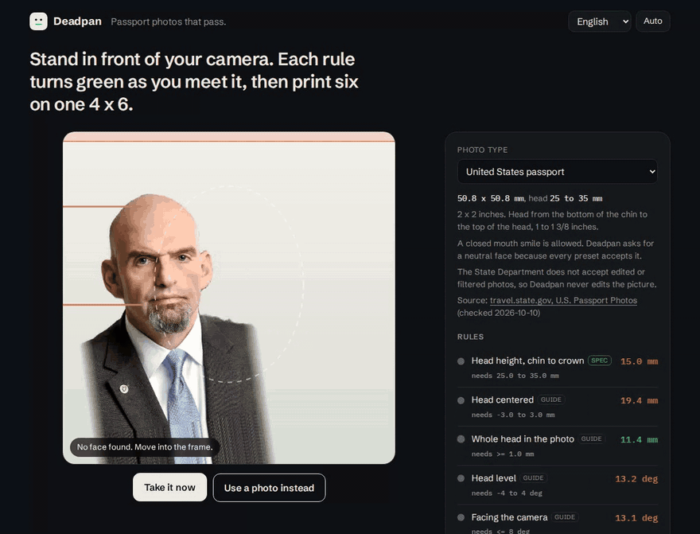

<p align="center">
  <picture>
    <source media="(prefers-color-scheme: dark)" srcset="assets/logo-dark.svg">
    
  </picture>
</p>

<p align="center"><b>Passport photos that pass.</b><br>
A live camera guide in your browser. Each rule turns green as you meet it, then six copies land on one 4 x 6 print.</p>

<p align="center">
  <a href="https://github.com/Arthur031221/Deadpan/actions/workflows/ci.yml"></a>
  
  
</p>

<p align="center">
  <a href="https://arthur031221.github.io/Deadpan/"><b>Open the page</b></a> |
  <a href="#install">Install</a> |
  <a href="docs/accuracy.md">Accuracy</a> |
  <a href="docs/sources.md">Sources</a>
</p>

<p align="center"></p>

**Deadpan's head size verdict matched my hand measurements on 29 of 30 test photos.** I ran it on 30 public domain portraits and compared each result with chin and crown points I marked by hand. All 20 photos it passed are inside the US 25 to 35 mm window by those points. The median error was 1.0 mm and the worst was 2.5 mm. <sub>Method in [Numbers](#numbers).</sub>

- **Not an upload.** The face model runs in your tab. The page ships a Content Security Policy that blocks requests to every other origin, and a test checks it.
- **Not only a crop box.** It measures chin to crown on the live camera and gives you the number while you are still standing there.
- **Not a guess.** Every rule says whether its number comes from the issuing authority's page or is Deadpan's own tolerance. Sources and read dates are in [docs/sources.md](docs/sources.md).

## Before and after

| | The usual way | Deadpan |
| --- | --- | --- |
| Where your face goes | A photo counter or a paid site that takes the file | Nowhere. The picture stays in your browser tab |
| Feedback | After the shot, from a clerk | Live, one line per rule with the measured value |
| Price | Walgreens lists $16.99 for two prints and a digital copy ([PhotoAiD, page dated 2025-05-22](https://photoaid.com/walgreens-passport-photo)) | Free. You pay only for one 4 x 6 print, which holds six US photos |

## Install

```sh
npx github:Arthur031221/Deadpan
```

That starts a local server and opens `http://localhost:4173`. Browsers only allow the camera on localhost or https, so the page is served instead of opened as a file.

<details>
<summary>Run from a clone</summary>

```sh
git clone https://github.com/Arthur031221/Deadpan
cd Deadpan
npm ci
npm start
```

</details>

<details>
<summary>Host it yourself</summary>

Copy the `app/` folder to any static host that serves https. There's no build step and no server code. Models, fonts and the gzipped WebAssembly runtime are in the folder, so the page doesn't call a CDN.

</details>

<details>
<summary>Use it on a phone</summary>

Open the hosted page in the phone's browser and allow the camera. I checked the layout at 390 px wide. I haven't tried a real phone camera yet, so treat that path as untested.

</details>

## Numbers

| What I measured | Result | Method |
| --- | --- | --- |
| Head height against hand marked points | The pass or fail verdict matched on 29 of 30 photos. All 20 passes are inside 25 to 35 mm by hand. Median error 1.0 mm, worst 2.5 mm | 30 public domain official portraits, listed in `test/fixtures/annotations.json`. I marked chin and crown on a ruler overlay before comparing. Run `npm run fit`. One person marked the points and I read them to about 1 percent of head height. Ten of the portraits are cropped too tightly for a 2 inch photo, and Deadpan refuses them instead of padding the picture |
| Requests to other origins in a full camera session | 0 | An end to end test records every request while Chromium plays a recorded clip as its camera, takes the picture and builds the sheet. It also tries a fetch to another origin and expects the policy to block it |
| Print sheet | 1200 x 1800 px, 300 dpi in the JPEG header, six US photos | The same test reads the downloaded file. A unit test packs eight 35 x 45 mm photos on the same paper |
| Digital file for US visas | Square JPEG, 600 to 1200 px, under 240 KB | An end to end test downloads it and checks the size |

The photos are formal portraits of adults, mostly smiling, so the accuracy says little about children, hats or heavy shadows. Every photo is in the table at [docs/accuracy.md](docs/accuracy.md).

## What it checks

| Rule | Basis | Limit |
| --- | --- | --- |
| Head height, chin to crown | Spec | The range of the chosen preset |
| Head centered | Guide | Within 6 percent of the photo width |
| Whole head in the photo | Guide | At least 1 mm above the crown and below the chin |
| Head level | Guide | Roll within 4 degrees |
| Facing the camera | Guide | Yaw and pitch within 8 degrees |
| Neutral, mouth closed | Guide | MediaPipe smile score at most 0.25 and jaw open at most 0.12 |
| Eyes open | Guide | Blink score at most 0.5 |
| Enough pixels to print | Guide | At least 300 dpi at the printed size |

The background row shows brightness and spread but has no pass or fail, since no preset gives a number for it.

## Presets

| Preset | Photo | Head | Source |
| --- | --- | --- | --- |
| United States passport | 2 x 2 in | 25 to 35 mm | [travel.state.gov](https://travel.state.gov/content/travel/en/passports/how-apply/photos.html) |
| United States visa, digital | 2 x 2 in | 25.4 to 35 mm | [travel.state.gov](https://travel.state.gov/content/travel/en/us-visas/visa-information-resources/photos/digital-image-requirements.html) |
| Taiwan passport | 35 x 45 mm | 32 to 36 mm | [boca.gov.tw](https://www.boca.gov.tw/np-140-2.html) |
| Schengen visa | 35 x 45 mm | 32 to 36 mm (ICAO) | [Czech MFA](https://mzv.gov.cz/jnp/en/information_for_aliens/supporting_documents_overview/photo.html) |
| Your own size | any | any | numbers you type |

Planned: the United Kingdom, Japan and India, once I can check each authority's page by eye. Canada needs a commercial photographer, so a home print would be refused.

## How it works

1. MediaPipe Face Landmarker finds 478 points. The chin is point 152, the pupils and cheeks give roll and centering, and the face transform gives yaw and pitch.
2. The top of the head comes from MediaPipe's selfie segmenter, run on a square around the head. The crown is the first row where a band half a face wide holds enough person pixels, so hair counts, as it does in the agencies' wording.
3. Once the crop is known, millimetres per pixel is the photo height divided by the crop height. Every rule is arithmetic on that scale.
4. The sheet tiles the photo on 4 x 6 in or A6 at 300 dpi, turns it a quarter when that fits more copies, and writes the density into the JPEG header.

The page never edits the face or the background. The State Department doesn't accept edited photos.

## Limits

- The chin landmark sits about 3 percent of head height low on average, and it stops above the bottom of a beard. Three bearded portraits in the test set read 1 to 6 percent short.
- Tall hair or a hat can reach past the region the segmenter sees. Deadpan then declines to measure the head instead of guessing.
- It can't judge shadows, glare or glasses. Look at the picture yourself.
- Tested in Chromium only. Firefox and Safari should work, but I haven't run them.
- Printers and kiosks sometimes rescale. Print at 100 percent, no fit to page, and measure a photo with a ruler.
- Four presets only. Browser tools such as [IDPhotoSnap](https://idphotosnap.com) cover far more countries. Deadpan adds the live guide and leaves your picture unedited. You can rerun the measurement with `npm run fit`.
- Authorities decide, and this tool doesn't. Check yours.

## Develop

```sh
npm test           # unit tests
npm run test:e2e   # Chromium with a fake camera
npm run fit        # head height against the hand marked points
```

See [CONTRIBUTING.md](CONTRIBUTING.md) for adding a preset. The models, fonts and portraits are listed in [THIRD_PARTY.md](THIRD_PARTY.md).

## License

MIT. MediaPipe and its models are Apache 2.0.
